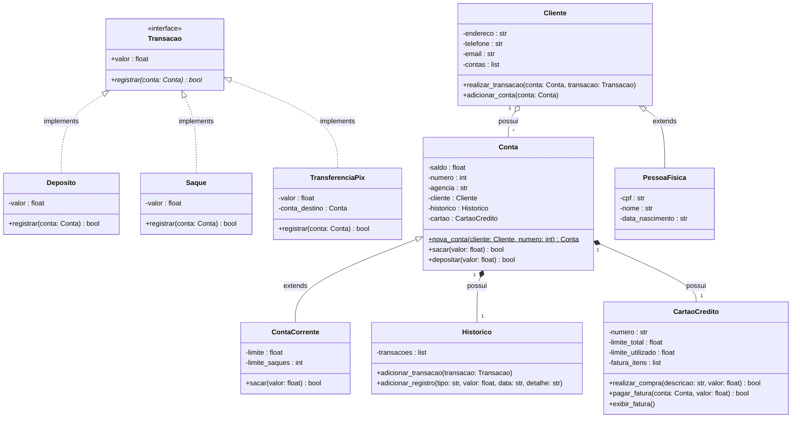

# 🏦 Sistema Bancário DGBANK (v3.5 POO Completo) — Desafio Python DIO

Sistema Bancário Completo em Python modelado sob o paradigma de **Programação Orientada a Objetos (POO)** e arquitetado conforme o **Diagrama de Classes UML** oficial da [Digital Innovation One (DIO)](https://www.dio.me/).

---

## 🌟 O que há de novo na Versão Completa (v3.5)

Além dos requisitos solicitados pela DIO, o sistema foi elevado ao nível de um **banco real e robusto**:

1. **Validação Real de CPF Oficial:**
   - Algoritmo oficial da Receita Federal (cálculo dos dois dígitos verificadores).
   - Bloqueio de números repetidos inválidos (como `111.111.111-11`).
   - Verificação instantânea se o CPF já está cadastrado, exibindo a ficha completa do cliente caso já exista.
2. **Cadastro Completo de Cliente:**
   - Nome, CPF, Data de Nascimento, Telefone, E-mail, Data/Hora de abertura de cadastro e Endereço detalhado (Logradouro, Número, Bairro, Cidade e Sigla do Estado).
3. **Cartão de Crédito e Fatura:**
   - Todo cliente com conta corrente recebe um cartão de crédito vinculado.
   - Gestão de limite total e limite disponível.
   - Lançamentos e extrato de fatura detalhada com descrição e valor de compras.
   - Pagamento de fatura debitando diretamente do saldo da conta corrente com restabelecimento do limite.
4. **Transferências PIX:**
   - Transferência instantânea entre contas correntes cadastradas com registro em tempo real para ambos os titulares.
5. **Extrato e Histórico de Atividades Completo:**
   - Tabela organizada com Data/Hora precisa, Tipo de Operação (Depósito, Saque, PIX, Fatura), Valores e Detalhes adicionais.
   - Visão consolidada de Saldo em Conta + Fatura em Aberto + Limite Disponível.

---

## 📐 Diagrama de Classes UML



---

## ⚙️ Menu e Funcionalidades do Terminal

```text
══════════════════════════════════════════════════
║   🏦  BANCO DGBANK — SISTEMA COMPLETO   ║
║      Contas • Cartão • Extrato • PIX     ║
══════════════════════════════════════════════════
──────────────────────────────────────────────────
  [d]  💰  Depositar
  [s]  💸  Sacar
  [p]  ⚡  Transferência PIX
  [e]  📄  Extrato Completo & Histórico
  [f]  💳  Fatura do Cartão de Crédito
  [k]  🛍️  Simular Compra no Crédito
  [pg] 💵  Pagar Fatura do Cartão
  [u]  👤  Novo Cliente (Cadastro Completo)
  [du] 🔍  Consultar Dados do Cliente
  [c]  🏦  Nova Conta Corrente
  [l]  📋  Listar Contas
  [q]  🚪  Sair
──────────────────────────────────────────────────
```

---

## 🚀 Como Executar

```bash
# Clone o repositório
git clone https://github.com/Dgfelippe/sistema-bancario-python.git

# Acesse o diretório
cd sistema-bancario-python

# Execute o sistema
python banco.py
```

---

## 👤 Autor

Desenvolvido por **Diogo Felippe**  
GitHub: [@Dgfelippe](https://github.com/Dgfelippe)

Feito com 💙 para o desafio **Modelando o Sistema Bancário em POO com Python** da DIO.
