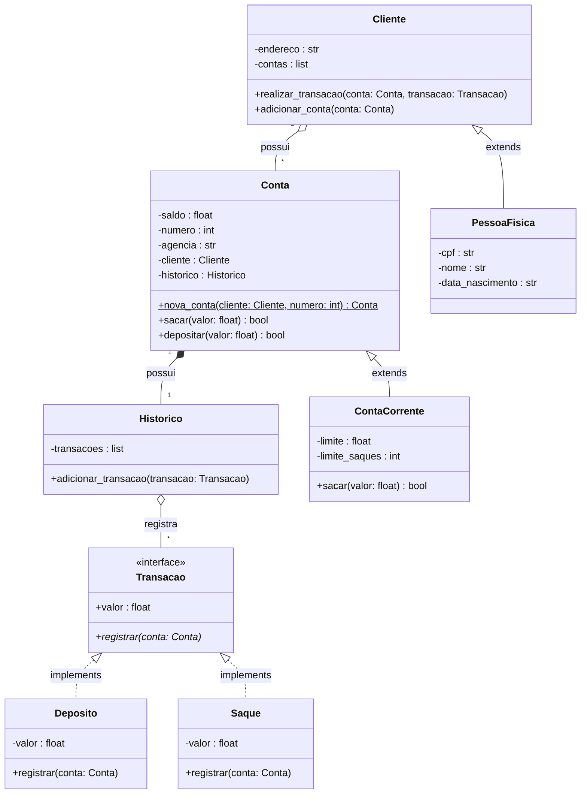

# 🏦 Sistema Bancário DGBANK (v3 POO) — Desafio Python DIO

Projeto desenvolvido como parte da **Trilha de Python AI Backend Developer** da [Digital Innovation One (DIO)](https://www.dio.me/).

## 📋 Sobre o Projeto

Sistema bancário de terminal que simula operações reais de contas bancárias e clientes. Na **Versão 3 (v3)**, o sistema foi totalmente remodelado e refatorado de dicionários e funções soltas para o **Paradigma de Programação Orientada a Objetos (POO)**, seguindo fielmente o **Diagrama de Classes UML** oficial do desafio da DIO.

---

## 📐 Modelagem de Classes UML



---

## ⚙️ Funcionalidades

| Operação | Descrição |
|---|---|
| 💰 **Depósito** | Registra objeto de `Deposito` por meio do cliente na conta |
| 💸 **Saque** | Valida regras de limite por saque (R$ 500,00) e saques diários (3 saques) |
| 📄 **Extrato** | Exibe histórico detalhado formatado com data/hora e saldo |
| 👤 **Novo Usuário/Cliente** | Instancia objeto `PessoaFisica` com CPF validado |
| 🏦 **Nova Conta Corrente** | Cria instância `ContaCorrente` associada ao cliente titular |
| 📋 **Listar Contas** | Lista contas formatadas usando o método `__str__` |

---

## 🚀 Como Executar

**Pré-requisito:** Python 3.10+ instalado.

```bash
# Clone o repositório
git clone https://github.com/Dgfelippe/sistema-bancario-python.git

# Acesse a pasta
cd sistema-bancario-python

# Execute o programa
python banco.py
```

---

## 🖥️ Demonstração do Menu

```text
══════════════════════════════════════════════
║   🏦  BANCO DGBANK (POO) — Bem-vindo(a)!   ║
══════════════════════════════════════════════
──────────────────────────────────────────────
  [d] 💰  Depositar
  [s] 💸  Sacar
  [e] 📄  Ver Extrato
  [u] 👤  Novo Usuário / Cliente
  [c] 🏦  Nova Conta Corrente
  [l] 📋  Listar Contas
  [q] 🚪  Sair
──────────────────────────────────────────────
  👉 Escolha uma opção:
```

---

## 📚 Conceitos de POO Aplicados

- **Abstração:** Interfaces e classes abstratas utilizando o módulo `abc` (`ABC` e `@abstractmethod`).
- **Encapsulamento:** Atributos protegidos com convenção `_` e expostos através de `@property`.
- **Herança:** `ContaCorrente` herda de `Conta`, e `PessoaFisica` herda de `Cliente`.
- **Polimorfismo:** Método `sacar` sobrescrito na classe `ContaCorrente` invocando `super().sacar(valor)`.
- **Métodos Especiais e de Classe:** Uso de `@classmethod` (`nova_conta`) e sobrescrita de `__str__`.

---

## 👤 Autor

Desenvolvido por **Diogo Felippe**  
GitHub: [@Dgfelippe](https://github.com/Dgfelippe)

Feito com 💙 durante o desafio **Modelando o Sistema Bancário em POO com Python** da DIO.
